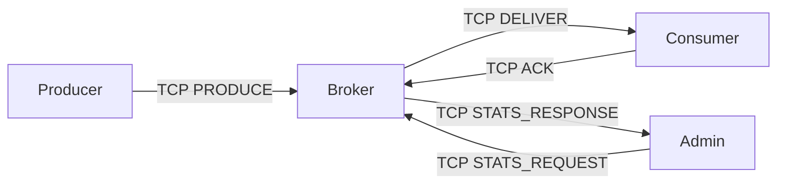
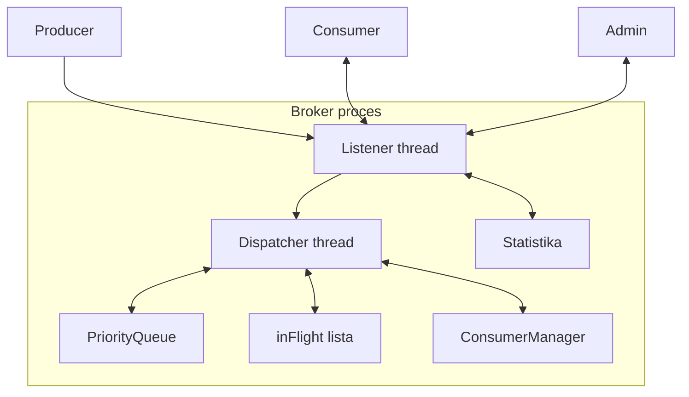
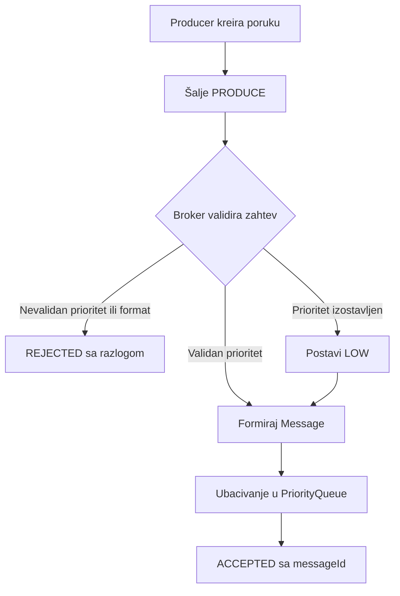
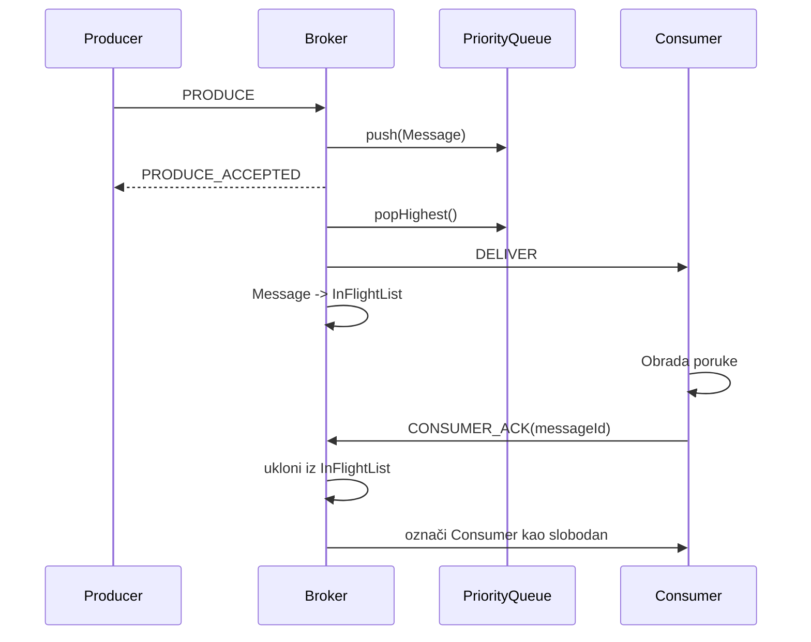
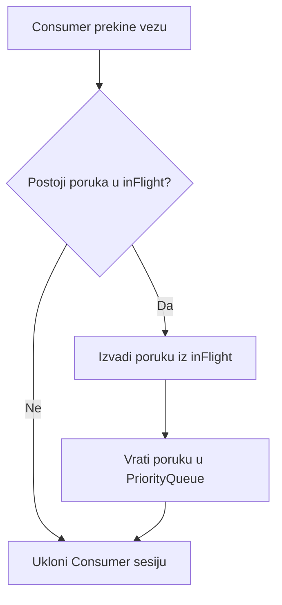
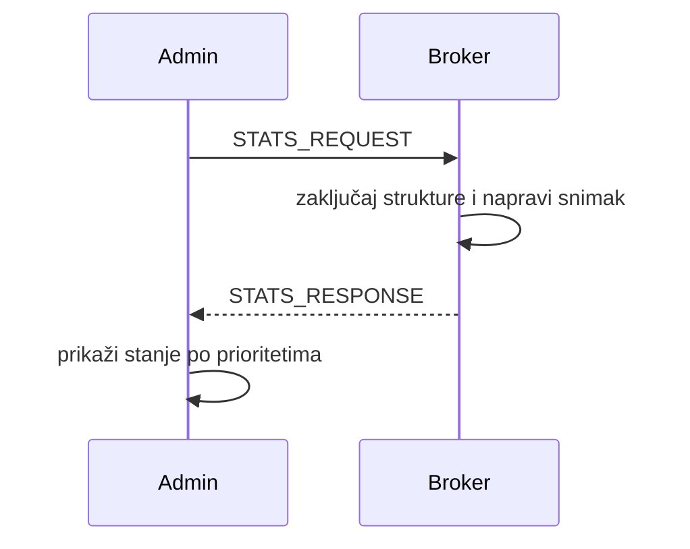

# Priority Message Queue – arhitektura rešenja

## 1. Uvod

Sistem predstavlja posrednika za razmenu poruka između procesa koji proizvode
poruke (**Producer**) i procesa koji ih obrađuju (**Consumer**). Za razliku od
običnog FIFO reda, Broker poruke obrađuje prema prioritetu:

```text
HIGH -> MEDIUM -> LOW
```

Poruke istog prioriteta obrađuju se prema vremenu slanja.

## 2. Zahtevi sistema

| Oznaka | Zahtev | Način realizacije |
|---|---|---|
| Z1 | Prioritet može biti izostavljen | Broker tada dodeljuje `LOW` |
| Z2 | Dozvoljeni prioriteti su `LOW`, `MEDIUM`, `HIGH` | Validacija u Broker-u |
| Z3 | Nevalidan prioritet se odbija sa razlogom | `REJECTED` odgovor Producer-u |
| Z4 | Viši prioritet ima prednost | Tri liste u `PriorityQueue` strukturi |
| Z5 | Isti prioritet prati vreme slanja | Sortirano umetanje u listu |
| Z6 | Admin vidi brojno stanje | `STATS_REQUEST` / `STATS_RESPONSE` |
| Z7 | Poruka se briše tek nakon prijema | `inFlight` stanje i `ACK` |
| Z8 | Prekid Consumer-a ne sme izgubiti poruku | Vraćanje nepotvrđene poruke u red |

## 3. Komponente sistema

Sistem se sastoji od četiri konzolne aplikacije:



### 3.1 Producer

Producer kreira poruku i šalje je Broker-u. Prioritet može biti:

- `LOW`, `MEDIUM` ili `HIGH`;
- izostavljen, kada Broker postavlja `LOW`;
- nevalidan, kada Broker vraća odbijanje.

Producer za svaku poruku čeka odgovor `ACCEPTED` ili `REJECTED`.

### 3.2 Broker

Broker je centralna komponenta. On:

1. prihvata TCP konekcije;
2. prima i proverava poruke;
3. dodeljuje podrazumevani prioritet;
4. ubacuje prihvaćene poruke u prioritetni red;
5. šalje poruke slobodnom Consumer-u;
6. vodi evidenciju nepotvrđenih poruka;
7. obrađuje `ACK`;
8. odgovara Admin procesu.

### 3.3 Consumer

Consumer se prijavljuje Broker-u, prima jednu poruku, obrađuje je i šalje
`ACK`. Consumer je zauzet dok se njegova poruka ne potvrdi.

### 3.4 Admin

Admin šalje zahtev za stanje i prikazuje:

- broj poruka prioriteta `HIGH`;
- broj poruka prioriteta `MEDIUM`;
- broj poruka prioriteta `LOW`;
- broj poruka u stanju `inFlight`;
- broj povezanih Producer-a i Consumer-a;
- ukupan broj prihvaćenih, odbijenih i potvrđenih poruka.

## 4. Arhitektura Broker-a



### 4.1 Thread model

Koriste se ograničene i jasno definisane uloge:

#### `TListener`

- prihvata nove konekcije;
- prima zahteve od Producer-a, Consumer-a i Admin-a;
- prosleđuje zahteve Broker logici;
- ne obavlja dugotrajnu obradu poruka.

#### `TDispatcher`

- validira i prihvata Producer zahtev;
- ubacuje poruku u `PriorityQueue`;
- bira slobodnog Consumer-a;
- premešta poruku u `inFlight`;
- inicira slanje poruke.

#### Consumer receiver thread

Za svakog povezanog Consumer-a postoji jedan mali receiver thread koji:

- čeka `ACK`;
- oslobađa Consumer-a;
- uklanja potvrđenu poruku iz `inFlight`;
- pri prekidu vraća nepotvrđenu poruku u red.

## 5. Entiteti sistema

### 5.1 `Priority`

```cpp
enum Priority : uint8_t {
    PRIORITY_NONE = 0,
    PRIORITY_LOW = 1,
    PRIORITY_MEDIUM = 2,
    PRIORITY_HIGH = 3
};
```

`PRIORITY_NONE` postoji samo u ulaznom zahtevu i znači da Producer nije zadao
prioritet. U samom redu svaka poruka ima efektivni prioritet.

### 5.2 `Message`

```cpp
struct Message {
    uint64_t messageId;
    Priority priority;
    uint64_t sentTimestamp;
    uint64_t receiveSequence;
    uint32_t payloadLength;
    char* payload;
};
```

Značenje polja:

| Polje | Značenje |
|---|---|
| `messageId` | Jedinstveni identifikator koji dodeljuje Broker |
| `priority` | Efektivni prioritet poruke |
| `sentTimestamp` | Vreme slanja koje šalje Producer |
| `receiveSequence` | Redni broj prijema u Broker-u za izjednačavanje vremena |
| `payloadLength` | Dužina sadržaja |
| `payload` | Dinamički alociran sadržaj poruke |

`receiveSequence` omogućava deterministički redosled kada dve poruke imaju isti
timestamp.

### 5.3 `ProduceRequest`

```cpp
struct ProduceRequest {
    Priority requestedPriority;
    uint64_t sentTimestamp;
    uint32_t payloadLength;
    char* payload;
    SOCKET producerSocket;
};
```

Ovaj entitet postoji samo tokom prijema i obrade Producer zahteva. Nakon
prihvatanja iz njega nastaje `Message`.

### 5.4 `ProducerSession`

```cpp
struct ProducerSession {
    SOCKET socket;
    uint32_t producerId;
    bool connected;
};
```

Sesija predstavlja aktivnu TCP vezu Producer-a. Jedna sesija može poslati više
poruka.

### 5.5 `ConsumerSession`

```cpp
struct ConsumerSession {
    SOCKET socket;
    uint32_t consumerId;
    bool connected;
    bool busy;
    uint64_t inFlightMessageId;
};
```

`busy` određuje da li Consumer trenutno čeka obradu ili potvrdu prethodne
poruke. `inFlightMessageId` je nula kada Consumer nema poruku.

### 5.6 `AdminSession`

```cpp
struct AdminSession {
    SOCKET socket;
    bool connected;
};
```

Admin ne dobija poruke iz reda, već samo šalje zahteve za statistiku.

### 5.7 `InFlightMessage`

```cpp
struct InFlightMessage {
    Message* message;
    uint32_t consumerId;
    uint64_t deliveryTimestamp;
};
```

Poruka se nalazi u `inFlight` strukturi nakon slanja Consumer-u, a pre
prijema `ACK` poruke. Broker i dalje poseduje poruku u ovom stanju.

### 5.8 `QueueStatistics`

```cpp
struct QueueStatistics {
    uint32_t queuedLow;
    uint32_t queuedMedium;
    uint32_t queuedHigh;
    uint32_t inFlight;
    uint32_t connectedProducers;
    uint32_t connectedConsumers;
    uint64_t totalAccepted;
    uint64_t totalRejected;
    uint64_t totalAcked;
};
```

Statistika se formira pod zaštitom odgovarajućih mutex-a, tako da Admin dobija
konzistentan snimak stanja.

## 6. Strukture podataka

### 6.1 `SortedMessageList`

Dvostruko povezana lista čiji su elementi pokazivači na `Message`.

```cpp
class SortedMessageList {
public:
    void insertSorted(Message* message);
    Message* popFront();
    bool empty() const;
    uint32_t size() const;
};
```

Lista je sortirana po paru:

```text
(sentTimestamp, receiveSequence)
```

`insertSorted` traži odgovarajuće mesto, `popFront` vraća najstariju poruku, a
`size` se koristi za Admin statistiku.

### 6.2 `PriorityQueue`

```cpp
class PriorityQueue {
private:
    SortedMessageList low;
    SortedMessageList medium;
    SortedMessageList high;

public:
    void push(Message* message);
    Message* popHighest();
    uint32_t count(Priority priority) const;
    bool empty() const;
};
```

`popHighest` uvek proverava liste redom `high`, `medium`, `low`. Time se pravilo
prioriteta direktno vidi u implementaciji i dokumentaciji.

### 6.3 `ConsumerList`

Ručno implementirana lista `ConsumerSession` objekata. Omogućava:

- registraciju Consumer-a;
- pronalaženje po `consumerId`;
- izbor prvog slobodnog Consumer-a;
- uklanjanje prekinute sesije.

Za očekivani broj klijenata linearna pretraga je dovoljna i jednostavnija od
HashMap strukture.

### 6.4 `InFlightList`

Ručno implementirana lista objekata `InFlightMessage`. Omogućava pronalaženje
poruke prema `messageId`, što je potrebno kada stigne `ACK` ili kada Consumer
prekine vezu.

### 6.5 Vlasništvo nad memorijom

Poruka u svakom trenutku pripada tačno jednoj od sledećih celina:

```text
ProduceRequest -> PriorityQueue -> InFlightList -> oslobođena memorija
```

Ako slanje Consumer-u ne uspe ili Consumer prekine vezu:

```text
InFlightList -> PriorityQueue
```

Ovo pravilo sprečava duplo oslobađanje i gubitak poruke.

## 7. Komunikacioni protokol

TCP je tok bajtova, pa svaka aplikativna poruka koristi zaglavlje:

```cpp
#pragma pack(push, 1)
struct FrameHeader {
    uint32_t bodyLength;
    uint8_t type;
};
#pragma pack(pop)
```

Zajednički kod mora imati `sendAll` i `recvAll`, jer jedan `send` ili `recv`
ne mora obraditi ceo okvir.

### 7.1 Tipovi poruka

| Tip | Smer | Sadržaj |
|---|---|---|
| `PRODUCE` | Producer -> Broker | prioritet, timestamp, dužina i payload |
| `PRODUCE_ACCEPTED` | Broker -> Producer | `messageId`, efektivni prioritet |
| `PRODUCE_REJECTED` | Broker -> Producer | kod i opis razloga |
| `CONSUMER_HELLO` | Consumer -> Broker | prijava Consumer-a |
| `CONSUMER_WELCOME` | Broker -> Consumer | dodeljeni `consumerId` |
| `DELIVER` | Broker -> Consumer | identifikator, prioritet i payload |
| `CONSUMER_ACK` | Consumer -> Broker | `messageId` |
| `STATS_REQUEST` | Admin -> Broker | zahtev bez tela |
| `STATS_RESPONSE` | Broker -> Admin | `QueueStatistics` |

### 7.2 Kodovi odbijanja

Broker odbija zahtev kada je:

- prioritet van dozvoljenog opsega;
- payload duži od maksimalne dozvoljene veličine;
- okvir neispravan;
- Broker u procesu gašenja.

Producer u svakom slučaju dobija jasan kod razloga, a ne samo informaciju da
poruka nije prihvaćena.

## 8. Tokovi rada

### 8.1 Slanje poruke



### 8.2 Isporuka i potvrda



### 8.3 Prekid Consumer-a



Poruka se ponovo sortira prema originalnom vremenu slanja i može je preuzeti
drugi Consumer.

### 8.4 Admin zahtev



## 9. Sinhronizacija

Koriste se Win32 kritične sekcije:

| Mutex | Štiti |
|---|---|
| `queueMutex` | tri liste u `PriorityQueue` |
| `consumerMutex` | Consumer sesije i njihova zauzetost |
| `inFlightMutex` | nepotvrđene poruke |
| `statisticsMutex` | zbirne brojače |

Pravila:

1. Struktura se zaključava samo tokom promene podataka.
2. `send` i `recv` se ne pozivaju dok se drži `queueMutex`.
3. Ako je potrebno više mutex-a, zaključavaju se uvek istim redosledom:
   `queueMutex`, `inFlightMutex`, `consumerMutex`.
4. Pre slanja se poruka premešta u `inFlight`, pa se ne drži zaključavanje tokom
   mrežne operacije.
5. Svaki `ACK` može se obraditi samo jednom.

## 10. Gašenje sistema

Pri gašenju Broker:

1. prestaje da prihvata nove konekcije;
2. obaveštava radne threadove;
3. čeka da se threadovi završe;
4. zatvara Producer, Consumer i Admin sokete;
5. oslobađa poruke iz reda i `inFlight` liste;
6. briše kritične sekcije;
7. poziva `WSACleanup`.

Ovim se sprečava curenje memorije i otvorenih socket handle-ova.

## 11. Test plan

### 11.1 Funkcionalni testovi

| Test | Očekivani rezultat |
|---|---|
| Poruka bez prioriteta | Prihvaćena kao `LOW` |
| Prioritet `HIGH`, `MEDIUM`, `LOW` | Prihvataju se i pravilno raspoređuju |
| Prioritet `9` | Odbijen uz `INVALID_PRIORITY` |
| Mešane poruke bez Consumer-a | Čuvaju se u odgovarajućim listama |
| Jedan Consumer | Isporuka ide `HIGH`, pa `MEDIUM`, pa `LOW` |
| Isti prioritet | Starija poruka se isporučuje prva |
| Admin pre i posle ACK-a | Brojevi odgovaraju realnom stanju |
| Consumer prekine vezu | Nepotvrđena poruka se vraća u red |
| Više Producer-a | Poruke se primaju bez gubitka |
| Gašenje Broker-a | Soketi, threadovi i memorija se oslobađaju |

### 11.2 Jednostavan test opterećenja

Predlog je pet Producer procesa sa po 100 poruka, dva Consumer procesa i
nasumičnim prioritetima. Proveravaju se:

```text
ukupno prihvaćeno = ukupno potvrđeno + broj u redu + broj u inFlight
```

Posebno se proverava da Admin može dobiti odgovor dok Producer-i šalju poruke.

## 12. Organizacija Visual Studio rešenja

```text
PriorityMessageQueue/
├── Common/
│   ├── Protocol.h
│   ├── Net.h
│   └── Net.cpp
├── DataStructures/
│   ├── Message.h
│   ├── SortedMessageList.h
│   ├── SortedMessageList.cpp
│   ├── PriorityQueue.h
│   └── PriorityQueue.cpp
├── Broker/
│   ├── main.cpp
│   ├── Broker.h
│   ├── Broker.cpp
│   ├── Listener.cpp
│   ├── Dispatcher.cpp
│   └── ConsumerManager.cpp
├── Producer/
│   └── main.cpp
├── Consumer/
│   └── main.cpp
└── Admin/
    └── main.cpp
```
